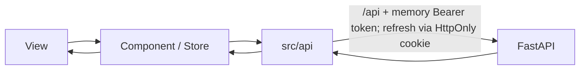

# 前端架构

> 状态：当前结构说明与渐进式优化目标  
> 代码根目录：`ecommerce/frontend/`

## 当前目录职责

| 路径 | 职责 | 约束 |
| --- | --- | --- |
| `src/views/` | 路由页面和页面级编排 | 不复制服务端定价、权限或支付规则 |
| `src/components/` | 可复用 UI、3D 查看器和配置面板 | 通过 props/events 或明确 store 交互 |
| `src/api/` | Axios 客户端与领域 API | 统一超时、认证头和错误映射 |
| `src/store/` | Pinia 用户、购物车和通知状态 | 本地状态不是交易事实来源 |
| `src/router/` | 路由表与导航守卫 | 守卫改善体验，但不能代替后端授权 |
| `src/design-system/` | token、基础样式和组件约束 | 页面不得重复定义同类视觉常量 |
| `src/data/` | 展示或演示数据 | 不作为生产商品、价格或库存来源 |
| `src/utils/` | 无状态工具和容错策略 | 不隐藏网络副作用 |
| `src/__tests__/` | Vitest 测试 | 覆盖关键交易流程和失败路径 |
| `public/models/` | 可公开加载的 3D 资产 | 必须确认来源、许可和大小预算 |

## 数据流



- API 基地址使用同域 `/api`，生产环境不应把内网后端地址写入前端包。
- 登录态由用户 store 管理，access token 只驻留内存；Axios 请求拦截器添加 Bearer token，401 时通过 HttpOnly refresh cookie 尝试刷新一次。
- 游客购物车可保存在浏览器；登录后由后端合并。订单金额和 DIY 配置价格必须由后端重算。
- 路由守卫只能隐藏或引导页面；管理员 API 必须继续使用后端 `get_current_admin` 授权。

## 浏览器安全边界

当前浏览器路径已不再从 `localStorage` 恢复 access/refresh token：access token 只驻留内存，refresh token 由后端设置为 `HttpOnly` Cookie，登录/刷新默认响应体也不暴露 refresh token。旧版本写入的两个 localStorage key 会在会话清理时移除；非浏览器客户端仍可在短期兼容窗口内提交 refresh token 请求体并显式请求旧响应格式。

生产目标：

1. access token 尽量短期、仅驻留内存；生产 refresh token 使用 `HttpOnly + Secure + SameSite=Lax` Cookie，刷新接口只轮换 cookie，不把 cookie 作为业务授权凭据。
2. 引入严格 CSP，清理不必要的内联脚本和第三方脚本。
3. 前端不得包含 Supabase Secret Key、支付宝私钥、数据库口令或 SMTP 凭据。
4. 外链跳转、富文本、文件预览和 3D 资源 URL 必须限制协议和来源。
5. 所有用户可见错误使用统一错误码映射，不显示堆栈、SQL、密钥或第三方原始响应。

## 渐进式结构目标

不建议一次性移动全部页面。新功能或重构中的 checkout/payment/catalog/account 可逐步进入 `src/features/<domain>/`，每个 feature 包含自身组件、状态、API 适配和测试；共享 UI 留在 `components`，共享 DTO 进入 `types`。旧 `store/` 在有真实模块迁移时再统一为 `stores/`。

## 验证

在 `ecommerce/frontend/` 执行：

```bash
npm run typecheck
npm test
npm run build
```

涉及登录、结算、支付、管理员或 3D 的变更，还必须验证 401/403、超时、重复提交、资源加载失败和移动端布局。
