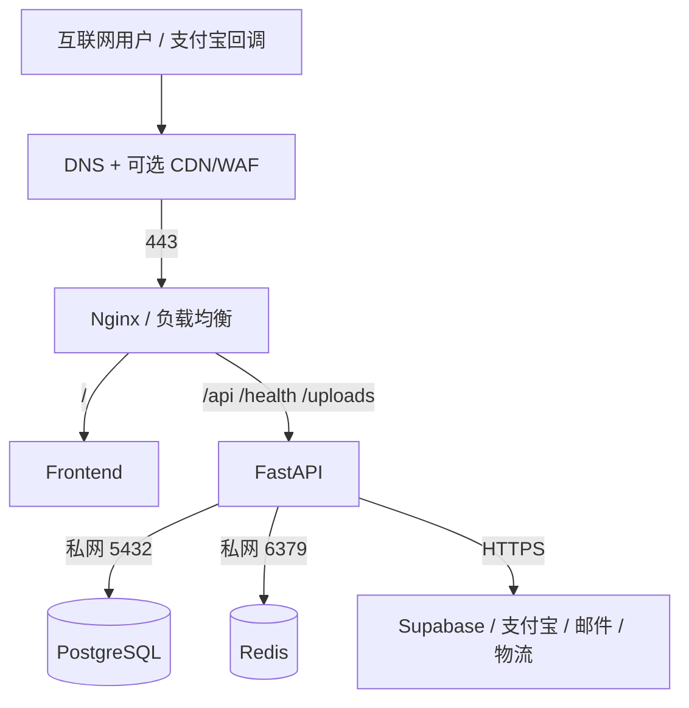

# 网络与安全

> 状态：生产安全基线  
> 适用读者：后端、运维、安全、测试及发布负责人

本页把“仓库当前能力”和“生产必须达到的目标”分开。任何阻断项未关闭时，都不能把系统描述为可承载真实支付的生产环境。

## 网络分区与流量

| 流向 | 端口/协议 | 公网可见 | 要求 |
| --- | --- | --- | --- |
| 用户到入口 | 443/TCP | 是 | TLS 1.2+，有效证书，推荐 TLS 1.3 |
| HTTP 到入口 | 80/TCP | 是 | 只做 ACME 校验和 301/308 跳转 HTTPS |
| 运维到主机 | 22/TCP | 受限 | 仅堡垒机或固定管理 IP，密钥登录，禁止密码直登 |
| 入口到前后端 | 容器私网 | 否 | 不发布 3000/8000 到公网 |
| 后端到 PostgreSQL | 5432/TCP | 否 | 安全组只允许应用子网或容器网络 |
| 后端到 Redis | 6379/TCP | 否 | 强认证，安全组仅允许应用访问 |
| 后端到第三方 | 443/TCP | 出站 | DNS、证书校验、超时、受控重试和告警 |

生产安全组不得对 `0.0.0.0/0` 开放 22、3000、8000、5432 或 6379。数据库和 Redis 优先部署在独立私网或托管服务中。

## 域名与 TLS

当前 `ecommerce/docker/nginx/nginx.conf` 只配置了 HTTP server，虽然 Compose 暴露 443 并挂载证书目录，但这不等于 HTTPS 已完成，属于上线阻断项。

生产目标：

1. DNS 将正式域名指向负载均衡或公网入口，证书覆盖该域名并自动续期。
2. 80 端口只跳转到 HTTPS；443 配置证书链、私钥和现代 TLS 参数。
3. Nginx 正确传递 `X-Forwarded-Proto`、`X-Forwarded-For` 和原始 Host，应用只信任已知代理。
4. HTTPS 验证通过后再启用 HSTS；若包含子域，先确认所有子域都支持 HTTPS。
5. Swagger/ReDoc 在生产默认关闭、仅内网开放或额外认证；`/health` 只返回最小状态。

## 应用层控制现状

| 控制 | 当前状态 | 结论/下一步 |
| --- | --- | --- |
| CORS 白名单 | 已实现，生产要求明确 HTTPS origin | 只列真实前端 origin，禁止通配符 |
| 请求体大小 | FastAPI 与 Nginx 均有限制 | 继续为不同上传接口设置单文件限制 |
| 安全响应头 | 已有基础头和非 DEBUG HSTS | 增加 CSP；统一 Nginx/FastAPI 的 frame 策略 |
| JWT + bcrypt | 已实现 | 增加撤销/轮换策略和异常登录监控 |
| token 存储 | access token 仅内存；refresh token 为 `HttpOnly` Cookie，响应体默认不返回 refresh token | 生产要求 `Secure + SameSite=Lax`，旧 localStorage 凭据清理 |
| CSRF | 配置项存在，未形成完整链路 | 使用 Cookie 后必须实现 CSRF 防护 |
| 限流 | 未实现统一策略 | 登录、注册、刷新、支付、上传和查询接口必须限流 |
| 主机校验 | 未看到 TrustedHost/等价控制 | 入口与应用限制允许 Host |
| CSP | 未实现 | 上线前制定并验证，不允许长期使用宽松通配 |
| 依赖/镜像扫描 | 质量计划中有要求 | 接入 CI，阻断高危且可利用漏洞 |

## 认证、授权与会话

- access token 当前 30 分钟、refresh token 当前 7 天，均由 HS256 签名。
- 前端通过 Bearer token 调用 API；后端每次从数据库重新加载用户并检查启用状态。
- 管理员权限必须由后端依赖检查，前端的管理员路由守卫不能作为安全控制。
- 生产密钥至少 32 字符并具备足够随机性，各环境独立，轮换时需要兼容窗口或强制重新登录。
- 当前会话方案：短期 access token 仅驻留内存；refresh token 放在 `HttpOnly; Secure; SameSite=Lax` Cookie 中，刷新接口轮换 refresh token。刷新接口不承载业务状态变更，受 SameSite 和同源 API 限制；若后续把认证凭据迁移为 Cookie，必须先补齐 CSRF token 链路。
- 登录、刷新、管理员操作和敏感资料修改应记录审计事件，但不得记录密码或完整 token。

## 支付宝回调安全

当前支付适配器已生成 RSA2 签名的 page-pay 请求，并在沙箱和生产模式都强制回调验签；真实商户联调、限流、TLS 和对账仍是上线前置条件。

正式回调必须同时满足：

1. 使用支付宝官方 SDK 或经过验证的 RSA2 实现校验签名，签名原文按官方规则构造。
2. 校验 `app_id`、`seller_id`、`out_trade_no`、`trade_no`、币种、精确金额和允许的交易状态。
3. 金额使用 Decimal 或分为单位比较，不使用二进制 float。
4. 回调处理以订单号/交易号建立数据库唯一约束和幂等记录；重复回调返回成功但不重复扣库存或记账。
5. 回调写入订单状态和 payment event 的同一事务，失败时整体回滚。
6. 回调入口不得依赖用户登录，但必须做验签、请求大小限制、频率控制和结构化审计。
7. 不仅依赖来源 IP 白名单；IP 白名单只能作为附加控制。
8. 上线前完成沙箱、篡改参数、重复回调、乱序回调、超时重试、金额不符和退款测试。

## 文件与 3D 资产

- 仅管理员可上传商品资产；同时校验扩展名、声明 MIME、文件签名和最大尺寸。
- GLB/GLTF、图片等上传内容使用不可预测对象名，存储路径经过规范化，禁止 `..` 和绝对路径。
- 上传目录不得允许脚本执行；下载响应使用正确 `Content-Type` 和 `X-Content-Type-Options: nosniff`。
- Supabase Secret Key 只能从后端环境注入；任何进入浏览器构建产物或仓库的 Secret Key 都应立即轮换。
- 公开 Bucket 只存确认可公开的内容；私有文件使用短期签名 URL。

## 密钥、日志和个人信息

- 生产凭据存入云密钥管理/KMS、部署平台 Secret 或受控环境变量，不写入 Git、镜像层、前端包、命令行历史和普通日志。
- 数据库、Redis、JWT、支付宝、SMTP、Supabase 各自使用独立凭据，禁止跨环境复用。
- 日志默认脱敏：Authorization、Cookie、密码、私钥、银行卡/支付原文、完整手机号、完整地址和第三方 Secret。
- 记录 request id、用户/订单的内部 ID、接口、状态码、耗时和错误类别；支付与管理员操作写独立审计事件。
- 日志、备份和对象存储设置最小权限、保留期和访问审计。

## 上线安全门禁

以下项目全部通过才允许真实交易：

- [ ] 域名 HTTPS、证书续期、HTTP 跳转和外部 TLS 扫描通过。
- [ ] 3000/8000/5432/6379 不对公网开放，22 仅受控来源。
- [ ] 支付宝商户沙箱/生产联调、RSA2 验签、精确金额、幂等、对账和退款路径验证通过。
- [x] 浏览器 refresh token 不再存储于 `localStorage`，生产预检强制 `AUTH_COOKIE_SECURE=true`；撤销/设备会话和完整 CSRF 策略仍待上线前验收。
- [ ] 登录、刷新、支付、上传和管理接口限流通过压测与绕过测试。
- [ ] CSP、Host 校验、生产 API 文档访问策略和安全头检查通过。
- [ ] 生产弱凭据预检、密钥托管、轮换和日志脱敏已由非作者复验。
- [ ] 数据库备份恢复、对象存储恢复和回滚演练有证据。
- [ ] 依赖、Secret、SAST、镜像和动态安全扫描无未接受的高危问题。

执行入口见[发布检查清单](../operations/release-checklist.md)。
