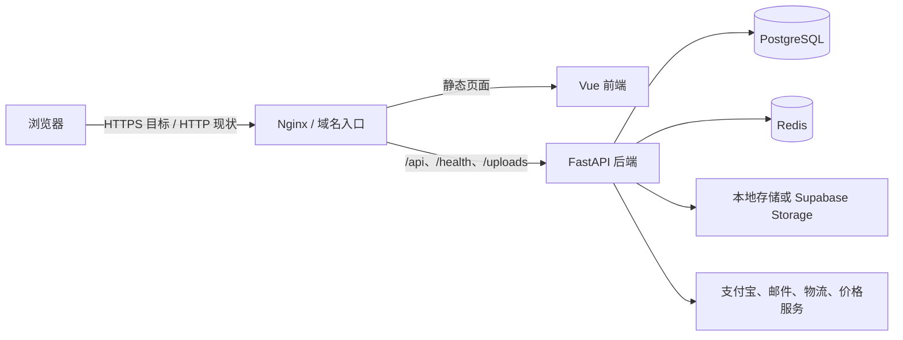

# 系统总览

> 状态：当前实现基线  
> 适用读者：全体研发、测试、运维和安全负责人

胖虫是前后端分离的电商应用。浏览器只通过同域入口访问 Vue 前端和 FastAPI API；PostgreSQL、Redis、Supabase Secret Key 与支付私钥都属于服务端信任域。

## 当前组件

| 层 | 目录 | 职责 |
| --- | --- | --- |
| Web 入口 | `ecommerce/docker/nginx/` | 静态入口、反向代理、请求大小和响应头基础配置 |
| 前端 | `ecommerce/frontend/` | Vue 页面、路由、Pinia 状态、Axios API、3D 展示 |
| 后端 | `ecommerce/backend/app/` | FastAPI API、认证、业务服务、数据库事务、第三方服务 |
| 数据库 | `ecommerce/database/`、Alembic | PostgreSQL schema、开发 seed 和生产迁移 |
| 缓存 | Redis | Compose 已配置；业务使用应按实际代码逐项确认 |
| 资产 | 本地 uploads 或 Supabase Storage | 商品图片和 3D 模型；Secret Key 仅由后端持有 |

## 请求链路

## 信任边界

1. 浏览器是不可信输入源。价格、库存、角色、订单金额和支付结果必须由服务端重新计算或验证。
2. Nginx 是公网入口。生产环境只开放 80/443；后端、数据库和 Redis 不直接暴露公网。
3. FastAPI 是业务信任边界。认证、授权、输入校验、事务和第三方签名验证都在此完成。
4. PostgreSQL 是交易事实来源。前端本地状态只用于交互，不是订单或支付真值。
5. Supabase Secret Key、JWT 密钥、数据库口令和支付私钥只允许出现在后端运行环境或密钥管理服务。

## 本地与生产差异

| 项目 | 本地开发 | 生产目标 |
| --- | --- | --- |
| 入口 | 3000/8000 可直接访问 | 统一域名，仅 80/443 对公网 |
| TLS | 可使用 HTTP | 必须 HTTPS，HTTP 仅跳转 |
| 数据 | 允许 demo seed | 禁止 demo seed，使用 Alembic 和受控导入 |
| 支付 | 站内模拟支付 | 支付宝 RSA2 适配器、验签、精确金额和支付事件幂等；真实商户对账待联调 |
| 密钥 | 本地弱值仅限隔离环境 | 独立强密钥，禁止写入仓库和镜像 |
| 资产 | 本地 uploads | 持久卷或 Supabase Storage，并具备备份策略 |

## 当前重要边界

- 已实现：同域 `/api` 调用、JWT Bearer 认证、CORS 白名单、请求大小限制、安全响应头、生产配置预检、服务端订单定价、本地/Supabase 资产后端。
- 部分实现：支付、缓存、日志与监控、TLS 终止、数据库迁移单一来源。
- 阻断项：当前 Nginx 配置没有可用的 443 server；真实支付宝商户联调、浏览器 token 安全 Cookie 和应用层没有统一限流仍待完成。

上线判断以[网络与安全](network-security.md)和[发布检查清单](../operations/release-checklist.md)为准。
