# 胖虫电商系统架构文档（历史版本）

> 已归档：本文包含已过时或尚未实现的结构与安全描述，不可作为当前生产基线。请改读[现行架构文档](../architecture/README.md)。

## 系统架构图

```mermaid
graph TB
    subgraph "前端展示层"
        A[Vue 3 + Pinia] --> B[TailwindCSS]
        A --> C[Vue Router]
        A --> D[Axios HTTP Client]
    end

    subgraph "后端逻辑层"
        E[FastAPI] --> F[SQLAlchemy ORM]
        E --> G[JWT Authentication]
        E --> H[Pydantic Validation]
    end

    subgraph "数据存储层"
        I[(PostgreSQL)]
        J[(Redis Cache)]
    end

    subgraph "三方服务"
        K[支付宝支付]
        L[快递鸟物流]
        M[Nodemailer邮件]
        N[Tawk.to客服]
    end

    subgraph "部署层"
        O[Nginx Reverse Proxy]
        P[Docker Compose]
    end

    D -->|HTTP/HTTPS| E
    E --> F
    F --> I
    E --> J
    E --> K
    E --> L
    E --> M
    A --> N
    O --> A
    O --> E
    P --> O
    P --> E
    P --> I
    P --> J
```



## 技术选型

### 前端技术栈

| 技术 | 版本 | 选择理由 |
|------|------|----------|
| Vue 3 | 3.4+ | 渐进式框架，学习曲线平缓，中文社区活跃，适合中小型项目 |
| Pinia | 2.1+ | Vue 3 官方状态管理，TypeScript 支持好，API 简洁 |
| Vue Router | 4.2+ | Vue 官方路由，支持嵌套路由、导航守卫 |
| TailwindCSS | 3.4+ | 原子化 CSS，开发效率高，易于定制主题 |
| Axios | 1.6+ | HTTP 客户端，支持拦截器、请求取消 |
| Vite | 5.0+ | 极速构建工具，HMR 热更新 |

### 后端技术栈

| 技术 | 版本 | 选择理由 |
|------|------|----------|
| Python | 3.11+ | 语法简洁，生态丰富，异步支持好 |
| FastAPI | 0.100+ | 高性能异步框架，自动 OpenAPI 文档，类型安全 |
| SQLAlchemy | 2.0+ | Python ORM 标准，支持异步，迁移工具成熟 |
| Alembic | 1.13+ | SQLAlchemy 官方迁移工具 |
| PostgreSQL | 16+ | 功能强大，JSON 支持好，适合生产环境 |
| Redis | 7.2+ | 缓存、会话存储、消息队列 |

### 部署技术栈

| 技术 | 用途 |
|------|------|
| Docker | 容器化部署 |
| Docker Compose | 多容器编排 |
| Nginx | 反向代理、静态资源、SSL 终端 |

## 项目结构

```
ecommerce/
├── backend/                    # 后端服务
│   ├── app/
│   │   ├── api/               # API 路由
│   │   │   ├── __init__.py
│   │   │   ├── auth.py        # 认证相关 API
│   │   │   ├── products.py    # 商品 API
│   │   │   ├── cart.py        # 购物车 API
│   │   │   ├── orders.py      # 订单 API
│   │   │   └── payment.py     # 支付 API
│   │   ├── core/              # 核心配置
│   │   │   ├── __init__.py
│   │   │   ├── config.py      # 配置文件
│   │   │   ├── security.py    # 安全相关
│   │   │   └── database.py    # 数据库连接
│   │   ├── models/            # 数据模型
│   │   │   ├── __init__.py
│   │   │   ├── user.py
│   │   │   ├── product.py
│   │   │   ├── cart.py
│   │   │   └── order.py
│   │   ├── schemas/           # Pydantic 模式
│   │   │   ├── __init__.py
│   │   │   ├── user.py
│   │   │   ├── product.py
│   │   │   ├── cart.py
│   │   │   └── order.py
│   │   ├── services/          # 业务逻辑
│   │   │   ├── __init__.py
│   │   │   ├── auth.py
│   │   │   ├── product.py
│   │   │   ├── cart.py
│   │   │   ├── order.py
│   │   │   ├── payment.py
│   │   │   └── logistics.py
│   │   ├── utils/             # 工具函数
│   │   │   ├── __init__.py
│   │   │   ├── email.py
│   │   │   └── helpers.py
│   │   └── main.py            # 应用入口
│   ├── migrations/            # 数据库迁移
│   ├── tests/                 # 测试
│   ├── alembic.ini
│   ├── requirements.txt
│   └── Dockerfile
├── frontend/                  # 前端应用
│   ├── src/
│   │   ├── components/        # 组件
│   │   ├── views/             # 页面
│   │   ├── store/             # Pinia 状态
│   │   ├── api/               # API 调用
│   │   ├── router/            # 路由
│   │   ├── assets/            # 静态资源
│   │   ├── App.vue
│   │   └── main.js
│   ├── public/
│   ├── index.html
│   ├── package.json
│   ├── vite.config.js
│   ├── tailwind.config.js
│   └── Dockerfile
├── database/                  # 数据库脚本
│   ├── init.sql              # 初始化脚本
│   └── seed.sql              # 测试数据
├── docker/                   # Docker 配置
│   ├── nginx/
│   │   └── nginx.conf
│   └── redis/
│       └── redis.conf
├── docker-compose.yml
└── docs/                     # 文档
    └── architecture.md
```

## 安全设计

### 认证与授权

- **JWT Token**: 无状态认证，Access Token 有效期 30 分钟，Refresh Token 有效期 7 天
- **密码加密**: 使用 bcrypt 算法，salt rounds = 12
- **API 保护**: 敏感接口需要认证，使用依赖注入检查 Token

### 数据安全

- **SQL 注入防护**: 使用 SQLAlchemy ORM 参数化查询
- **XSS 防护**: 前端使用 Vue 模板自动转义，后端使用 Pydantic 验证
- **CSRF 防护**: 使用 SameSite Cookie + CSRF Token
- **HTTPS**: Let's Encrypt 免费证书，Nginx 配置强制 HTTPS

### 支付安全

- **签名验证**: 支付回调使用 RSA2 签名验证
- **幂等性**: 订单号唯一，防止重复支付
- **金额校验**: 回调金额与订单金额必须一致

## 性能优化

### 缓存策略

- **Redis 缓存**: 商品列表、热门商品、用户会话
- **CDN 加速**: 静态资源（图片、CSS、JS）
- **浏览器缓存**: 静态资源设置 Cache-Control

### 数据库优化

- **索引设计**: 商品名称搜索索引、用户 ID 外键索引
- **连接池**: SQLAlchemy 连接池配置
- **分页查询**: 使用 LIMIT/OFFSET 或游标分页

### 前端优化

- **代码分割**: Vue Router 路由懒加载
- **图片优化**: WebP 格式、懒加载
- **Gzip 压缩**: Nginx 配置 Gzip 压缩
