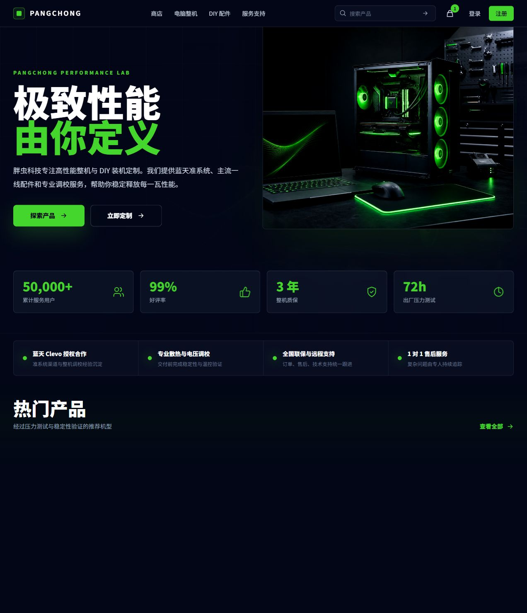
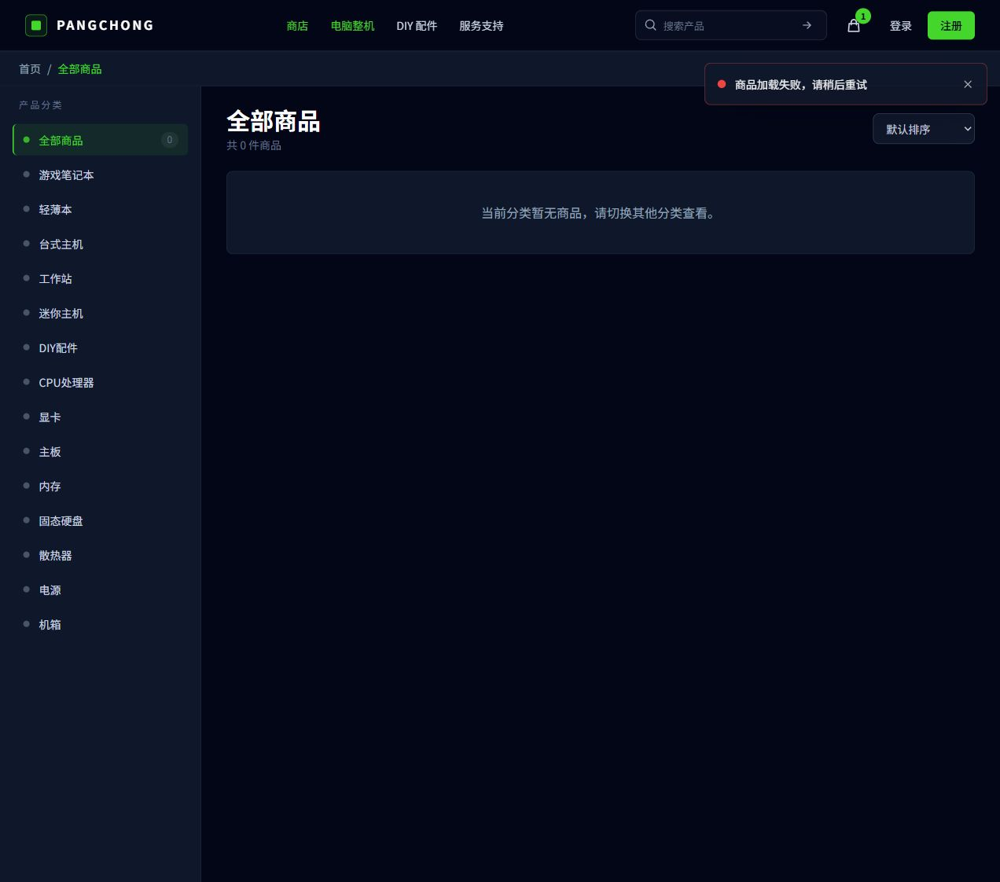
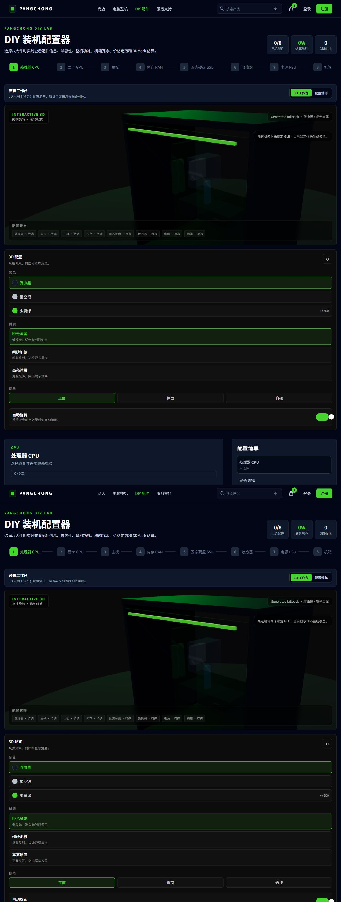
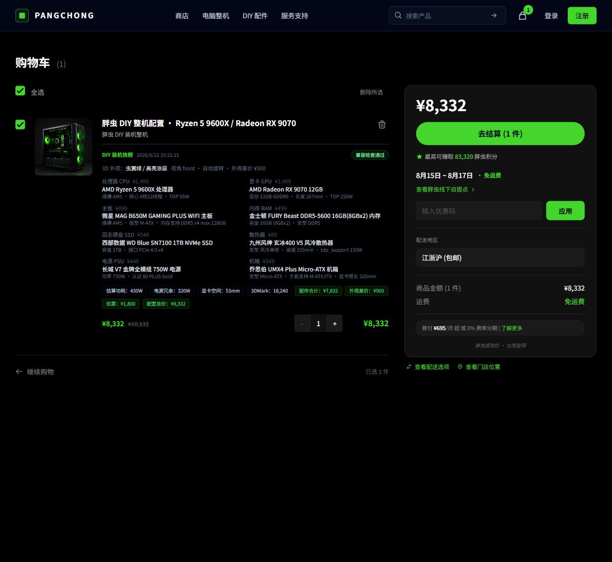
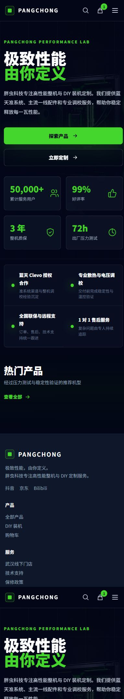

# UI 审计与前端优化方案

审计日期：2026-08-10  
范围：首页、商品列表、DIY 装机、购物车、390px 移动端首页。  
条件：本地前端可运行，但后端商品接口未启动；商品与 DIY 候选为空。该失败状态本身被纳入审计。

## 结论

品牌视觉已经达到可继续迭代的水平，最大问题不是“看起来不够像大厂”，而是**成功态精致、失败态和高密度交易态没有同等质量**。最优先要修的是数据失败降级、正文可读性、DIY 的渐进呈现和购物车的信息压缩。

综合健康度：**6.7 / 10**。

| 维度 | 判断 |
| --- | --- |
| 品牌辨识 | 8/10：黑色、虫翼绿、硬件影像统一 |
| 任务聚焦 | 7/10：首页清楚；DIY 与购物车同时暴露太多信息 |
| 状态完整 | 5/10：商品接口失败后出现大空白和“0 件商品”冲突 |
| 一致性 | 5/10：约 770 处颜色/圆角硬编码，页面半径与灰阶不统一 |
| 可读性 | 6/10：多处 10–12px 文字承载关键交易信息 |
| 可访问性 | 6/10：语义结构基本存在，但颜色、焦点、图标按钮和弹层仍需实测 |
| 响应式 | 7/10：首页移动端成立；长页面和高密度页面仍需专项检查 |

## 审计步骤

### 步骤 1：首页 — 基本健康

优点：主标题、双行动、服务证明和品牌影像形成完整叙事；导航搜索与购物车入口清楚。

问题：商品接口失败后“热门产品”下方留下大面积空白；没有 skeleton 后的错误恢复、静态推荐或服务入口。50,000+、99%、3 年和 72h 属于高强度承诺，应该能追溯数据口径。

改进：热门商品区域采用 `loading / success / empty / error / partial` 五态；失败时显示 2–4 个静态类目入口与重试动作。业务指标增加口径说明或改为可验证的服务事实。

可访问性风险：首屏背景图和前景图表达相同内容，替代文本应一个有意义、一个留空；绿色既表示品牌又表示成功与可点击，需配合文字或形状。

### 步骤 2：商品列表 — 高风险

优点：分类、结果标题、数量和排序区域清楚，错误 Toast 可见。

问题：接口失败时同时出现“共 0 件”“当前分类暂无商品”和“商品加载失败”，把系统错误误写成业务空状态。桌面侧栏在结果为空时仍占较大面积，用户只有“切换分类”而没有重试。

改进：错误态不显示 0 件，不允许把失败缓存为空数组；在主内容区显示“重新加载 / 返回全部商品 / 联系客服”。移动端分类改为抽屉，已选条件以可移除标签显示。

可访问性风险：Toast 自动消失时间、焦点是否移动到错误说明、筛选变化是否通过状态区播报，截图无法确认。

### 步骤 3：DIY 配置 — 功能完整但需要减负

优点：八步选件、功耗、兼容性、价格、3D/清单双模式已经形成闭环；3D 明确声明只是预览，交易流程可降级。

问题：空配置首屏同时出现 3D、外观、材质、视角、自动旋转、筛选、清单、兼容性、估算和价格记录，新手的第一步不够突出。接口失败后“0 / 0 款”和“没有匹配”再次把系统错误表现为筛选无结果。

改进：默认进入“引导模式”，只突出当前部件、推荐条件和候选；3D/外观作为右侧或二级页签。完成 2 个关键部件后再展开兼容性摘要，详细规则按问题展开。加载失败时保留当前已选配置并显示局部重试。

可访问性风险：8 步进度需要 `aria-current=step`；3D 控制必须支持键盘替代；自动旋转状态不能只靠颜色；信息变化需要 `aria-live` 摘要。

### 步骤 4：购物车 — 可成交但可读性不足

优点：价格、结算、配送、兼容性与配置快照在同一屏；右侧摘要和主行动稳定。

问题：配置详情以两列密集小字展开，10–12px 的规格、时间、价格和说明难以扫读；总价出现次数较多；折扣、积分、分期、门店、配送和优惠码同时竞争注意力。

改进：商品行默认只显示机型、3–5 个核心部件、兼容性与总价，其余放入“查看完整配置”。右侧摘要仅保留总价、配送、主行动，积分与分期降为折叠说明。正文不得低于 14px，辅助标签不得低于 12px。

可访问性风险：删除图标按钮在 DOM 中没有可访问名称；数量按钮的 `- / +` 需带商品名称；选择框与总价更新需播报。

### 步骤 5：390px 首页 — 基本健康

优点：主标题、按钮、数据卡和服务承诺在单列下仍成立，核心动作达到易点击尺寸。

问题：移动端首屏内容接近两屏，数据卡与服务承诺连续堆叠；热门商品失败后仍留下空区。页脚较长，核心服务链接与法律链接层级可进一步收敛。

改进：移动端数据卡先显示两项，服务承诺改为横向滑动或两项摘要；数据失败区域高度不得超过 240px；页脚按“购买 / 支持 / 关于”折叠。

可访问性风险：菜单打开后的焦点圈定、Esc 关闭和背景 inert 尚未验证。

## 最高影响修改

### P0：1–2 周

1. 建立所有数据区的五态组件，修复“错误 = 空数据”的语义冲突。
2. 统一正文与交易信息的最小字号，删除购物车 10px 关键文本。
3. 商品与 DIY 的接口失败采用局部错误，不让整页退化。
4. 删除、关闭、增减数量等图标按钮补全可访问名称与焦点状态。
5. 将新增 Token 接入 Tailwind，禁止新增十六进制颜色。
6. 为现有弹层补齐 focus trap、焦点回归、Esc 与背景 inert。

### P1：3–6 周

1. 首页：热门产品失败降级、主承诺口径、产品类目入口。
2. 商品页：移动筛选抽屉、条件标签、比较栏、结果相关性说明。
3. DIY：引导/专家模式、局部加载、摘要渐进展开、配置状态单一数据源。
4. 购物车：配置折叠、右侧摘要减负、价格与售后口径统一。
5. 结算：使用统一 Field/Button/Card，错误就地显示并跳转首个错误。
6. Services.vue（3735 行）和 DIY.vue（1245 行）按领域组件拆分。

### P2：6–12 周

1. 产品卡、价格来源、兼容性规则、Toast、Dialog 和 EmptyState 全部纳入组件库。
2. 1280、1024、768、390 四组视口视觉回归；增加 200% 缩放和减少动态效果。
3. 核心流程埋点：商品发现、首次选件、兼容风险修复、加入购物车、结算完成。
4. 建立设计系统变更记录、弃用周期和组件覆盖率。

## 验收指标

| 目标 | 门槛 |
| --- | --- |
| 状态完整 | 所有请求区均有 loading/success/empty/error/partial；错误不显示为 0 件 |
| 可读性 | 交易正文 ≥14px，输入 ≥16px（移动端），辅助文本 ≥12px |
| 对比度 | 普通文本至少 4.5:1；大文本和图形至少 3:1 |
| 操作尺寸 | 关键触控目标至少 44×44px |
| 响应式 | 390–1440px 无横向溢出；200% 缩放核心流程可完成 |
| 性能 | LCP ≤2.5s、CLS ≤0.1、INP ≤200ms（75 分位目标） |
| DIY | 首次用户 30 秒内完成第一件选配；3D 失败不阻断任何交易步骤 |
| 交易 | 关键不兼容配置无法进入结算；价格来源与时间可见 |

## 证据边界

- 本轮没有后端商品数据，无法判断成功态卡片、真实筛选量、图片质量与分页性能。
- 未登录，未完整走通地址、支付和订单成功流程。
- 截图不能证明键盘、屏幕阅读器、焦点圈定、色觉和真实网络性能合规。
- 当前结论只针对 2026-08-10 本地工作区版本与本轮截图。

