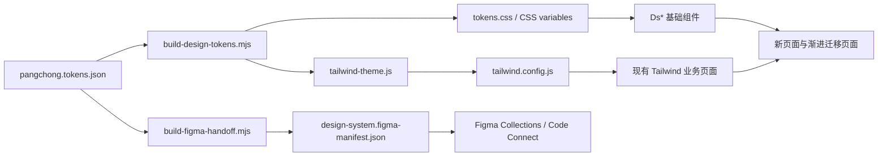

# 代码与设计系统映射 v0.9.11

> v0.9.11 新增 Figma handoff manifest、High Contrast mode 与大厂基准的可执行映射；完整 API 见 [06-component-contracts.md](06-component-contracts.md)。

## 1. 数据流

设计稿、Token 名、CSS 变量和组件 props 必须保持同一语义。设计侧命名 `color.semantic.action.primary`，代码侧对应 `--pc-color-semantic-action-primary`，Tailwind 兼容层对应 `primary-500`。Figma 的可执行映射由 handoff manifest 固化；没有目标 fileKey 时只登记映射，不把“计划同步”写成“已同步”。

## 2. Token 映射

| 设计 Token | CSS | Tailwind 兼容层 | 组件消费者 |
| --- | --- | --- | --- |
| `color.brand.500` | `--pc-color-brand-500` | `primary-500` | `DsButton`, `DsBadge` |
| `color.dark.950` | `--pc-color-dark-950` | `dark-950` | 现有页面背景 |
| `color.semantic.background.surface` | `--pc-color-semantic-background-surface` | 暂无，优先 CSS 变量 | `DsCard`, `DsEmptyState` |
| `color.semantic.text.primary` | `--pc-color-semantic-text-primary` | 暂无 | 所有 Ds 组件 |
| `color.semantic.border.focus` | `--pc-color-semantic-border-focus` | 暂无 | `DsButton`, `DsField` |
| `color.theme.home.*` | `--pc-color-theme-home-*` | 暂无，优先 CSS 变量 | `Home.vue` 营销渐变与商品媒体 |
| `color.theme.store.*` | `--pc-color-theme-store-*` | 暂无，优先 CSS 变量 | `Store.vue` 浅色门店主题 |
| `color.theme.service.*` | `--pc-color-theme-service-*` | 暂无，优先 CSS 变量 | `Services.vue` 服务中心画布、表面、边框、文字与打印态 |
| `radius.md` | `--pc-radius-md` | `rounded-md` | 按钮、输入 |
| `radius.lg` | `--pc-radius-lg` | `rounded-lg` | 卡片 |
| `space.6` | `--pc-space-6` | `p-6 / gap-6` | 默认卡片内边距 |
| `size.control.touch` | `--pc-size-control-touch` | 暂无，优先 CSS 变量 | Dialog/Alert/Icon 动作的最小触控目标 |
| `motion.duration.normal` | `--pc-motion-duration-normal` | 暂无 | hover/focus/切换 |
| `motion.duration.micro` | `--pc-motion-duration-micro` | 暂无 | 服务中心、导航等高频微交互 |
| `motion.duration.prominent` | `--pc-motion-duration-prominent` | 暂无 | 商品媒体和重点视觉状态过渡 |
| `motion.duration.ambient` | `--pc-motion-duration-ambient` | 暂无 | 首页氛围层和背景状态过渡 |
| `motion.duration.spin` | `--pc-motion-duration-spin` | 暂无 | 装饰性加载 spinner 周期 |
| `motion.duration.loading` | `--pc-motion-duration-loading` | 暂无 | Button/IconButton loading spinner 周期 |
| `motion.duration.shimmer` | `--pc-motion-duration-shimmer` | 暂无 | Skeleton shimmer 周期 |
| `motion.ease.linear` | `--pc-motion-ease-linear` | 暂无 | loading/shimmer 等匀速动效 |

Tailwind 的 `primary-*` 与 `dark-*` 已由 Token 生成，不再在 `tailwind.config.js` 重复维护。语义 Token 尚不强制转换为 Tailwind 类，以避免产生 `bg-background-surface` 之类难读的类名。

## 3. 基础组件映射

v0.9.2 新增 `DsChoiceCard.vue`，props 为 `modelValue/value/title/description/type/name/disabled`，用于结算地址、配送方式和支付方式；组件内部保持原生 radio/checkbox 语义。

| 设计组件 | Vue 组件 | 主要 props | 建议替换对象 |
| --- | --- | --- | --- |
| Button | `DsButton.vue` | `variant/size/loading/block` | `.btn*`、页面内 `bg-primary-500` 按钮 |
| Surface/Card | `DsCard.vue` | `padding/interactive/as` | `.card`、`bg-dark-900 rounded-*` 容器 |
| Status Badge | `DsBadge.vue` | `tone` | `.badge*`、兼容/库存/促销标签 |
| Text Field | `DsField.vue` | `as/label/hint/error/required/disabled/options/autocomplete/v-model` | `.input`、页面内 label + input/select 组合 |
| Empty/Error State | `DsEmptyState.vue` | `title/description/slots` | 商品、DIY、订单的业务空态 |
| Icon Button | `DsIconButton.vue` | `label/variant/size/pressed/loading` | 搜索、筛选、关闭、收藏、导航 |
| Menu | `DsMenu.vue` | `open/label/align/closeOnSelect` + trigger/default slots | 用户菜单、工具菜单和上下文操作 |
| Search Field | `DsSearchField.vue` | `modelValue/label/placeholder/submitLabel/compact` | 全局导航、服务支持、商品目录搜索 |
| Toggle | `DsToggle.vue` | `modelValue/label/disabled` | Cookie 偏好、布尔偏好设置；使用原生 `role=switch` |
| Checkbox | `DsCheckbox.vue` | `modelValue/label/description/disabled/mixed` | 购物车全选、批量操作；保留原生 checkbox 和 indeterminate |
| Skeleton | `DsSkeleton.vue` | `variant/width/height` | 商品、DIY、订单 loading |
| Alert | `DsAlert.vue` | `tone/title/description/dismissible` | 兼容性、价格来源、系统提示 |
| Toast | `DsToast.vue` | `visible/message/tone/dismissible` | 已加入购物车、保存结果、轻量操作反馈 |
| Contrast Toggle | `DsContrastToggle.vue` | persisted theme + `aria-pressed` | 全局高对比度偏好 |
| Async State | `DsAsyncState.vue` | `state/retry/emptyTitle/errorTitle` | 所有接口驱动内容区 |
| Tabs | `DsTabs.vue` | `tabs/modelValue/orientation` | 3D/清单、概览/规格/支持 |
| Dialog | `DsDialog.vue` | `open/title/description/size` | 删除确认、筛选、配置详情 |
| Product Card | `DsProductCard.vue` | `product/categoryLabel/fallbackImage/interactive` | 商品发现、推荐、搜索结果 |
| Cart Line Item | `DsCartLineItem.vue` | `item/selected/disabled/interactive/compact/fallbackImage` | 购物车编辑、结算只读预览、库存恢复 |
| Step Indicator | `DsStepIndicator.vue` | `steps/modelValue/allowNavigation` | 结算步骤、分段表单、已完成步骤回看 |
| Order Summary | `DsOrderSummary.vue` | `items/subtotal/shipping/discount/total/fallbackImage` | 结算侧栏、订单确认、价格事实汇总 |
| Price Summary | `DsPriceSummary.vue` | `subtotal/shipping/discount/total/itemCount/showTotal` | 购物车与订单摘要共享价格明细，避免重复实现 |
| DIY Part Picker | `DsDiyPartPicker.vue` | `product/selected/specs/selectionAdvice/fallbackImage` | DIY 配件候选卡、键盘选择、价格依据 |
| Order Success | `DsOrderSuccess.vue` | `open/orderNo/paying/paymentError` | Checkout 创建成功、支付失败重试、订单恢复 |
| Pagination | `DsPagination.vue` | `page/totalPages/maxVisible/pageLabel/pageSuffix/disabled` | 商品与订单列表页码、键盘焦点和屏幕阅读器当前页 |
| Order Timeline | `DsOrderTimeline.vue` | `events/title/eyebrow/currentLabel` | 订单详情履约进度、当前步骤与取消/退款分支 |
| Data Table | `DsDataTable.vue` | `label` + default table slot | 后台订单/商品表格的可聚焦滚动、最小密度和响应式承载 |
| Compatibility Status | `DsCompatibilityStatus.vue` | `status/compact` | DIY、订单快照、结算前风险提示 |
| Price Provenance | `DsPriceProvenance`（兼容入口：`PriceProvenance.vue`） | `product/compact` | 商品卡、详情页、结算前价格信任 |
| Media Category Card | `DsMediaCategoryCard.vue` | `image/title/description/href/linkLabel` | 首页与分类入口的图片主导卡片 |
| Commerce Navigation | `DsCommerceNav.vue` | `primaryItems/categoryItems/aria-current` | 商城一级任务与二级分类导航 |
| Workbench Shell | `DsWorkbenchShell.vue` | `nav/canvas/inspector` slots + `density` | DIY 三栏工作台与移动端顺序 |
| Parts Inspector | `DsPartsInspector.vue` | `parts/activeId/showPriceHistory` | 已选硬件、价格历史和当前检查项 |
| Build Summary | `DsBuildSummary.vue` | `price/compatibility/power/performance` | 配置过程中的价格、兼容性、功耗和性能事实 |

## 4. 业务页面迁移表

本轮交易路径迁移：`Checkout.vue` 使用 `DsChoiceCard`、`DsAlert`、`DsButton`、`DsField`；`user/Addresses.vue` 使用 `DsAsyncState`、`DsDialog`、`DsAlert` 和 `DsButton`；`Cart.vue` 使用 `DsDialog`、`DsToast`、`DsButton`；`DIY.vue` 使用 `DsAsyncState`、`DsStepIndicator`、`DsField`、`DsButton`；`AppNavbar.vue` 与 `ProductConfiguratorPanel.vue` 使用 `DsIconButton`。

| 页面/代码 | 当前模式 | 目标映射 | 优先级 |
| --- | --- | --- | --- |
| `Home.vue` | 首页氛围与商品媒体主题 | `color.theme.home.*` + semantic Token + `ProductCard` + `AsyncState` | 主题值已迁移；商品卡继续抽取 |
| `Store.vue` | 独立浅色门店主题 | `color.theme.store.*` + semantic layout tokens | 主题值已迁移；内容卡继续抽取 |
| `Products.vue` | Tailwind 页面，错误与空态混用 | `DsAsyncState` + `DsButton` + `DsPagination` + 筛选业务组件 | 分页与错误重试已接入 |
| `DIY.vue` | 单文件 1245 行，状态与编排集中 | `DsDiyPartPicker` + `DsAsyncState` + `DsStepIndicator` + `DsField` + `DsButton` + DIY 领域组件 + store | 配件候选卡、筛选字段、语义步骤、3D fallback、步骤与 CTA 已接入；状态编排继续拆分 |
| `Cart.vue` | 多组 `#111/#1A1A1A/#AAA` | `DsCartLineItem` + `DsDialog` + `DsToast` + `DsButton` + 语义表面/文本 Token | 商品行、删除确认、轻量反馈和结算 CTA 已接入；优惠券/运输选择继续迁移 |
| `App.vue` / 全局壳层 | 页面缺少统一跳过链接和主内容锚点 | `.skip-link` + `#main-content` + `scroll-margin-top` | 键盘用户可直接进入主要内容；页面过渡尊重 reduced motion |
| `Checkout.vue` | 页面内按钮、Field、步骤状态 | `DsStepIndicator` + `DsOrderSummary` + `DsCartLineItem` + `DsOrderSuccess` | 地址字段、成功反馈和支付失败恢复已接入 |
| `Orders.vue` | 页面内 spinner、空态和页码按钮 | `DsAsyncState` + `DsButton` + `DsPagination` | loading/empty/error/retry 和页码语义已统一 |
| `OrderDetail.vue` | 页面内 spinner、浏览器 alert/confirm、状态胶囊 | `DsAsyncState` + `DsAlert` + `DsDialog` + `DsOrderTimeline` + `DsButton` | 详情加载恢复、支付/取消反馈、履约时间线和不可逆操作确认已接入 |
| `admin/Orders.vue` | 原生 spinner、空态、Teleport 弹窗、页码按钮 | `DsAsyncState` + `DsDataTable` + `DsPagination` + `DsDialog` + `DsField` | 列表恢复、表格可聚焦滚动、详情/发货弹窗和移动端分页已接入 |
| `admin/Products.vue` | 原生 spinner、空态、Teleport 表单、alert | `DsAsyncState` + `DsDataTable` + `DsPagination` + `DsDialog` + `DsAlert` | 商品列表恢复、表单错误、资产上传错误和结果反馈已接入 |
| `admin/Layout.vue` | 固定 256px 侧栏在移动端挤压内容 | Tailwind responsive + mobile horizontal nav | 390px 隐藏桌面侧栏，导航仍可触达 |
| `AddressForm.vue` | 页面内 label/input/select 与错误文案 | `DsField(as=input/select)` + autocomplete/error/disabled 契约 | 省市区联动仍由页面负责，字段视觉和错误语义统一 |
| `Services.vue` | 服务中心页面主题与协议编排 | `color.theme.service.*` + `DsSearchField` + `ServicePolicyPanel` + `ServiceCookiePreferences` | 页面颜色迁移完成；搜索、hash、Cookie 与打印契约保留 |
| `AppNavbar.vue` | 独立复杂导航样式 | 导航 Token + `DsIconButton` + `DsSearchField` + `DsMenu` + mobile focus contract | 用户下拉菜单复用 `DsMenu`；移动搜索和图标动作已接入；移动菜单提供 `aria-expanded`、Escape 关闭、Tab 焦点圈定与触发器回焦；桌面搜索保留紧凑业务布局 |
| `Services.vue` | 服务中心页面主题与协议编排 | `color.theme.service.*` + `DsSearchField` + 服务章节组件 + 内容数据化 | 支持搜索、章节拆分与页面级颜色 Token 已接入 |
| `ServicePolicyPanel.vue` / `ServiceCookiePreferences.vue` | 服务章节与 Cookie 偏好内联结构 | `ServicePolicyPanel` + `DsToggle` + `DsButton` | 服务章节已抽取；开合、FAQ、Cookie 保存和 hash 锚点仍由 Services 编排 |
| `ProductConfiguratorPanel.vue` | 页面内颜色/材质/视角/自动旋转控制 | `DsIconButton` + `DsToggle` + semantic Token | 3D 控制器已移除硬编码色值与 `transition-all`，保留业务事件与选择状态 |
| `Cart.vue` | 页面内全选 checkbox | `DsCheckbox(mixed)` | 全选/部分选择/未选状态统一，批量删除仍由 `DsDialog` 确认 |
| `ProductConfiguratorPanel.vue` | 自定义重置图标按钮 | `DsIconButton` | 重置视角已接入；颜色/材质/视角选择保留业务专用 pressed 语义 |
| `PriceProvenance.vue` | 已有业务语义 | 纳入业务组件层，保留数据契约 | P1 |
| `DsMediaCategoryCard.vue` | Commerce media card | `DsMediaCategoryCard` + `color.semantic.*` + Comfortable density | 已实现；单一下一步链接与图片降级 |
| `DsWorkbenchShell.vue` | DIY 三栏工作台 | `DsWorkbenchShell` + layout/density Token | 已实现；移动端按导航、画布、检查器堆叠 |
| `DsPartsInspector.vue` | 硬件清单与检查器 | `DsPartsInspector` + `aria-pressed` | 已实现；行选择、空态和价格历史入口 |
| `Product3DViewer.vue` | 自有状态与降级 | `DsAsyncState` 统一加载占位；不重写 Three.js，由 `DIY.vue` 异步加载，`vite.config.js` 将 Three.js 独立为懒加载 chunk；配置清单模式卸载查看器 | 加载占位与按模式挂载已接入 |
| `ProductDetail.vue` | 页面内加载中、数量按钮、页面 CTA | `DsAsyncState` + `DsIconButton` + `DsButton` + `PriceProvenance` | 商品详情成功/空/错误、数量键盘操作和购买动作已统一 |
| `Login.vue` / `Register.vue` | 页面内 label/input/button/error | `DsField` + `DsAlert` + `DsButton` | 认证字段 autocomplete、错误语义和 loading 状态已统一 |
| `user/Profile.vue` | 页面内 label/input/status | `DsField` + `DsAlert` + `DsButton` | 个人资料字段与保存反馈已统一 |

## 5. Figma/设计稿映射约定

即使暂时没有 Figma 文件，设计命名也按以下结构：

- `Foundations/Color/{role}` → JSON `color.semantic.{role}`；
- `Foundations/Space/{step}` → JSON `space.{step}`；
- `Components/Button/{variant}/{state}/{size}` → `DsButton` props；
- `Components/Badge/{tone}` → `DsBadge tone`；
- `Patterns/DIY/PartPicker/{default|selected|warn}` → `DsDiyPartPicker` props；
- `Patterns/Commerce/OrderSuccess/{ready|paying|payment-error}` → `DsOrderSuccess` props；
- `Patterns/Navigation/Pagination/{first|middle|last}` → `DsPagination` props；
- `Patterns/Commerce/OrderTimeline/{pending|paid|shipped|completed|cancelled|refunded}` → `DsOrderTimeline` events/state；
- `Patterns/AsyncState/{loading|empty|error|partial}` → 业务 AsyncState；
- `Patterns/Service/PolicyPanel/{closed|open}` → `ServicePolicyPanel` 的 `open` 与 `aria-expanded`；
- `Patterns/Privacy/CookiePreferences/{default|saved}` → `ServiceCookiePreferences` + `DsToggle`；
- `Patterns/Service/Theme/{canvas|hero|surface|divider|text|print}` → `color.theme.service.*` → `Services.vue` 页面 CSS；
- `Patterns/DIY/{guided|expert}` → DIY 工作台模式。
- `Patterns/Commerce/MediaCategoryCard/{default|focused}` → `DsMediaCategoryCard` props；
- `Patterns/Commerce/Navigation/{global|category}` → `DsCommerceNav` props；
- `Patterns/Navigation/MobileMenu/{closed|open|keyboard-trapped}` → `AppNavbar` 的 `aria-expanded`、`aria-controls`、Escape 与 Tab 焦点行为；
- `Components/Menu/{closed|open|keyboard-navigation}` → `DsMenu` 的 trigger/default slots、Arrow/Home/End、Escape 与外部点击关闭；
- `Patterns/DIY/WorkbenchShell/{comfortable|compact}` → `DsWorkbenchShell` slots + `density`；
- `Patterns/DIY/PartsInspector/{empty|ready|active}` → `DsPartsInspector` props + events；
- `Patterns/DIY/BuildSummary/{default|warning|danger}` → `DsBuildSummary` props；

设计交付必须在组件旁标出：Token 名、组件名、变体、状态和内容 key；禁止只写颜色值或“同上”。服务中心的透明层使用对应 service Token 的 `-rgb` 变量加 alpha，不在页面 CSS 重新声明颜色值。

## 6. 开发约束

1. 修改 Token：只改 JSON，运行 `npm run design:tokens`。
2. 新组件：从 `@/design-system` 引入，不跨页面复制样式。
3. 新颜色/圆角：如果 Token 不存在，先在设计评审说明角色。
4. 业务组件可以组合基础组件，但不能覆盖内部焦点和 disabled 语义。
5. 旧代码硬编码逐页消化；新增硬编码在 code review 阶段阻断。
6. 完成迁移后运行 `npm run check`、`npm run design:tokens:check`、`npm run copy:check`。

## 7. v0.9.1 后台覆盖补充

| 页面 | 组合关系 | 设计意图 |
| --- | --- | --- |
| `admin/Users.vue` | `DsField` + `DsAsyncState` + `DsDataTable` + `DsPagination` + `DsDialog` + `DsAlert` | 用户列表的筛选、恢复、键盘滚动、详情和状态变更反馈统一走组件契约；破坏性操作先确认，不使用浏览器 `confirm`。 |
| `admin/Dashboard.vue` | `DsAsyncState` + `DsDataTable` | 仪表盘请求错误可重试，热销商品表格与订单/商品后台共用同一滚动和密度边界。 |
