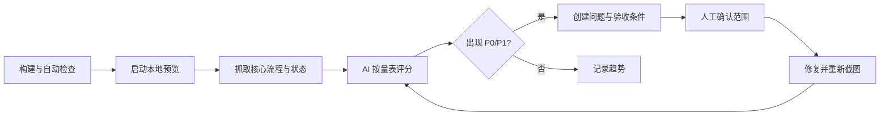

# AI UI 体验定期维护机制

目标不是让 AI 随机改样式，而是让它按固定证据、固定评分和固定权限发现退化，并把问题转成可验收任务。

已在 Codex 中启用 `PANGCHONG 每周 UI 体验巡检`：每周一 10:00（Asia/Shanghai）回到当前任务执行只读审计；它会提醒 P0/P1，不会自动修改源码或业务内容。v0.9.11 起，巡检同时核对 skip link/main 锚点、`DsSearchField`、`DsCheckbox` 的 mixed 状态、`ProductConfiguratorPanel` 的 Token/焦点/减少动态效果、`ServicePolicyPanel`、Cookie 开关的 `aria-checked`、保存反馈、首页热门商品异步状态、主题 Token 漂移、AppNavbar/Commerce Navigation 的唯一 `aria-current`、移动导航的 `aria-expanded`、Escape 关闭、Tab 焦点圈定与触发器回焦、商品排序字段的程序化标签、Workbench 的 density Token、3D 查看器占位与清单模式卸载，并扫描 UI 源码中的 `transition-all` 退化与全局 `prefers-reduced-motion` 降级。

## 1. 周期

| 周期 | 范围 | 产物 |
| --- | --- | --- |
| 每次 PR | 受影响页面，桌面 + 移动 | 截图差异、可访问性与状态清单 |
| 每周一 | 首页、商品、DIY、购物车、结算 | 15 分钟快速巡检，P0/P1 问题 |
| 每月首个工作日 | 全部核心流程 + 文案 + Token 漂移 | 月度体验报告、趋势、Top 5 债务 |
| 每季度 | 真实指标、客服问题、竞品变化 | 设计系统版本与路线复盘 |

## 2. 固定证据集

每次 AI 巡检必须使用本轮新证据，不能只读源码后主观判断：

1. 1280×800 与 390×844 页面截图；
2. 当前 DOM/可访问性结构；
3. loading、success、empty、error、partial 状态，以及 Toast/Alert 的结果反馈；
4. 键盘路径、200% 缩放、减少动态效果和高对比度切换；
5. 控制台错误、失败请求和关键性能指标；
6. Token/文案清单漂移结果（含 opacity、z-index 和通知语义）；
7. 若有数据，最近 4 周转化、退出和客服高频问题。

## 3. 核心巡检流程



## 4. AI 评分量表

每项 0–5 分，必须引用截图或步骤：

- 任务清晰度：首屏是否知道下一步；
- 信息层级：关键事实是否比辅助信息更醒目；
- 状态完整性：失败是否被误写为空；
- 一致性：Token、组件、文案和行为是否一致；
- 可读性：字号、行高、密度、对比度；
- 可访问性：键盘、焦点、名称、状态播报；
- 响应式：390–1440px、缩放与触控尺寸；
- 性能感知：加载反馈、布局稳定、3D 降级；
- 交易信任：价格、来源、库存、兼容、售后；
- 恢复能力：错误后是否有重试与替代路径。

低于 3 分必须创建任务；同一项连续两次下降必须进入月度 Top 5。

## 5. 问题分级

- **P0**：无法浏览/选配/加购/结算；关键不兼容仍可成交；价格口径错误；严重无障碍阻断。
- **P1**：主要任务明显变慢；错误与空态混淆；移动端不可完成；关键文字不可读。
- **P2**：一致性、密度、文案或次要交互问题。
- **P3**：视觉抛光和不影响任务的小问题。

每个问题必须包含：页面与步骤、当前截图、预期行为、涉及组件/Token、桌面与移动验收、证据边界。

## 6. AI 巡检提示词模板

```text
你是 PANGCHONG UI 体验维护员。只审计本轮提供的页面和截图，不凭记忆推断。

目标用户：希望可靠选购高性能整机或完成 DIY 配置的中国用户。
设计原则：性能可信、主任务唯一、语义 Token、渐进呈现、3D 可降级。

请对每个步骤检查：
1. 主任务和下一步；
2. loading/success/empty/error/partial；
3. 价格、库存、兼容性和来源；
4. 字号、密度、对比度和触控尺寸；
5. 键盘、焦点、名称、状态播报；
6. 390px 与 1280px 差异；
7. 是否偏离 Design Token 或复制造成新组件分叉。

输出：总体结论、逐步骤健康度、P0-P3 问题、每个问题的证据、建议组件/Token、可执行验收条件、无法从证据确认的限制。
不要自动改动业务、文案、价格或设计方向；先给证据和建议。
```

## 7. 自动检查与人工权限

AI 可自动执行：读取、构建、测试、截图、对比、生成报告和任务草稿。  
AI 不应自动执行：更改品牌方向、发布生产、改价格/政策文案、删除功能、合并 PR。

建议 CI 基线：

```powershell
npm run design:tokens:check
npm run design:lint
npm run copy:check
npm run typecheck
npm run test
npm run build
```

## 9. 结算流专项证据

结算页每轮必须额外核对三类证据：

- `DsStepIndicator`：当前步骤可辨识、已完成步骤可回退、未完成步骤不可跳过，并在 390px 下保留可访问名称。
- `DsOrderSummary`：商品、规格、数量、原价/现价、运费、优惠与应付金额必须同时出现在可读结构中，且与主订单确认区一致。
- `DsDiyPartPicker`：候选卡必须同时呈现选择态、关键规格、价格依据和兼容性建议；Enter/Space 选择结果与鼠标一致。
- `DsOrderSuccess`：创建成功、支付中、支付失败必须保持同一对话框语境，失败时可重试、查看订单或继续购物。
- `DsPagination`：当前页必须有 `aria-current="page"`；第一页上一页、最后一页下一页不可用；筛选条件变化后页码回到 1；省略号不能获得焦点。
- `DsOrderTimeline`：订单详情至少呈现订单提交和当前状态；当前节点必须有 `aria-current="step"`；取消/退款分支必须有明确文字，未返回的时间不得被前端编造。
- `OrderDetail.vue`：详情加载失败可重试；支付/取消失败在内容区可读且不丢失；取消动作必须进入 `DsDialog`，禁止浏览器 `alert/confirm`。
- `DsDataTable`：表格区域必须有 `role="region"` 和可访问名称；横向滚动容器可通过键盘聚焦；移动端不得把表格扩张为页面级横向溢出。
- `DsChoiceCard`：检查每组只允许一个 radio 选中；整卡点击、键盘焦点、选中状态和描述文本必须保持一致；结算选择组必须存在可访问的 legend/label。
- 后台运营页：订单/商品列表必须区分 loading、empty、error；详情、发货、商品编辑使用 `DsDialog`；390px 下侧栏隐藏后仍保留可横滑导航。
- 列表恢复：商品/订单列表的接口失败必须出现可重试的 error 状态，不能把失败响应记录为“暂无数据”。
- 订单确认态：商品行只读、地址/配送/支付信息可回看，移动端不出现横向溢出；控制台错误数必须为 0。
- 商品接口：先检查 `GET /health`，再检查 `GET /api/products?page=1&page_size=10`；若前端是 `npm run preview`，确认 4173 的 `/api` 代理目标与后端端口一致。

## 8. 月度报告结构

1. 本月总分与上月变化；
2. P0/P1 数量和关闭率；
3. 页面/组件退化热区；
4. Token、组件、文案覆盖率；
5. 性能与转化指标；
6. 下月 Top 5；
7. 需要产品、设计或业务确认的决策。

### 后台用户与仪表盘巡检

- 检查筛选、详情、状态变更和仪表盘请求是否复用 `DsAsyncState` / `DsDialog` / `DsAlert`。
- 禁止新增 `alert()`、`confirm()`、页面级 spinner 和无恢复动作的错误态。
