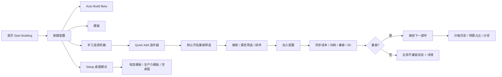
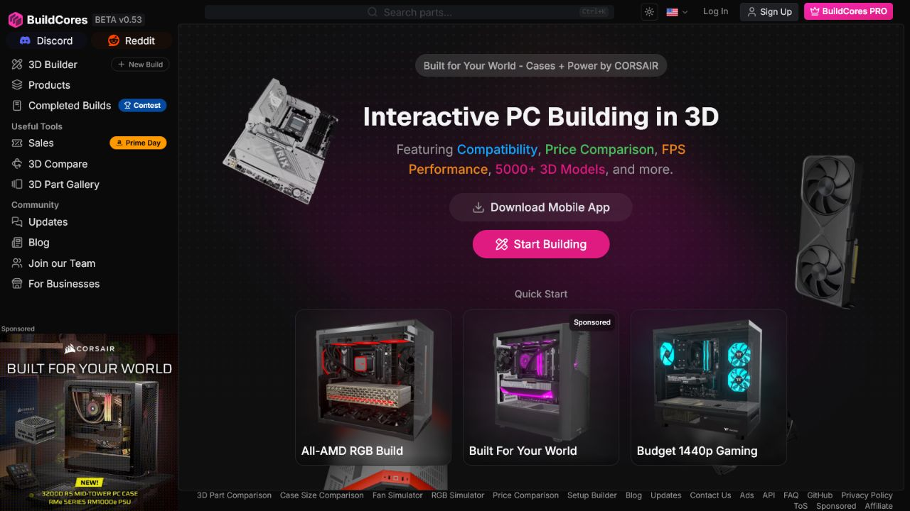
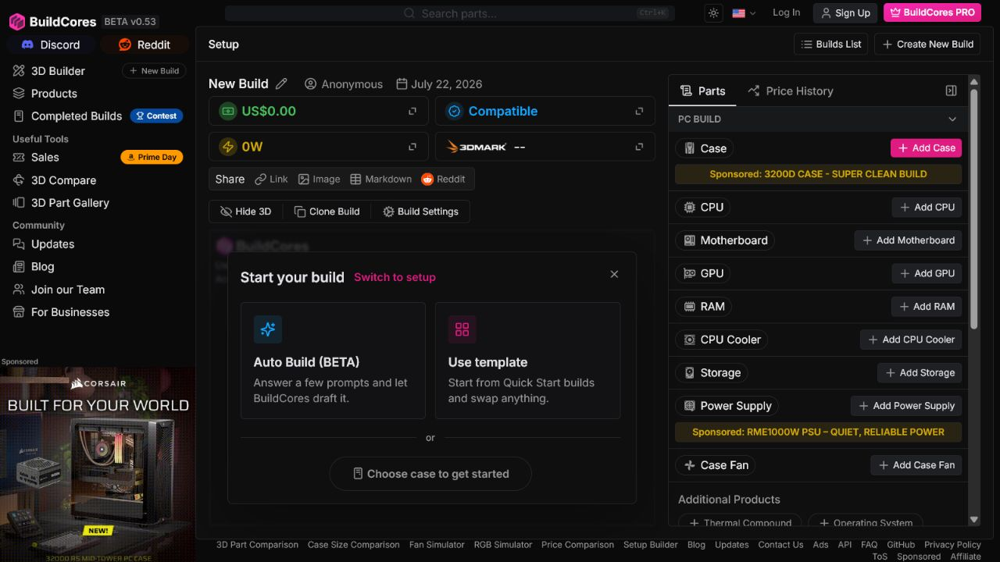
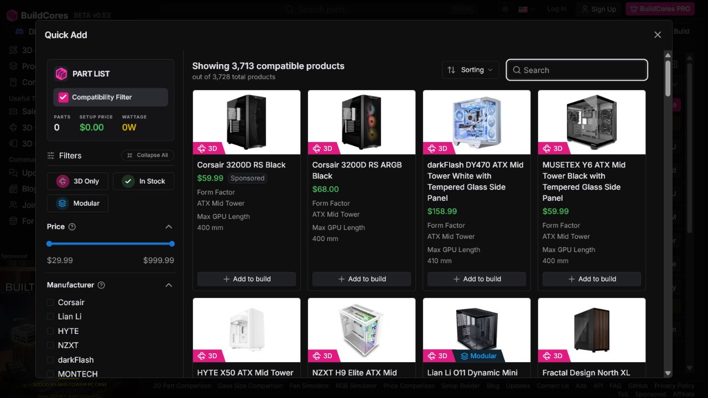
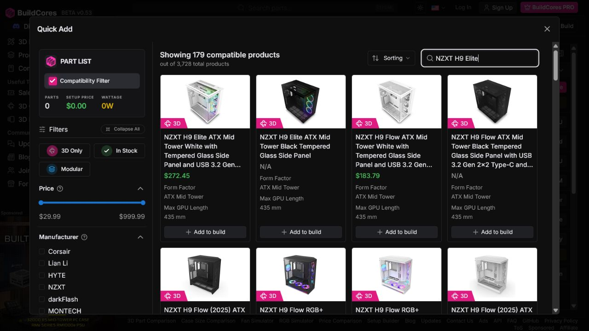
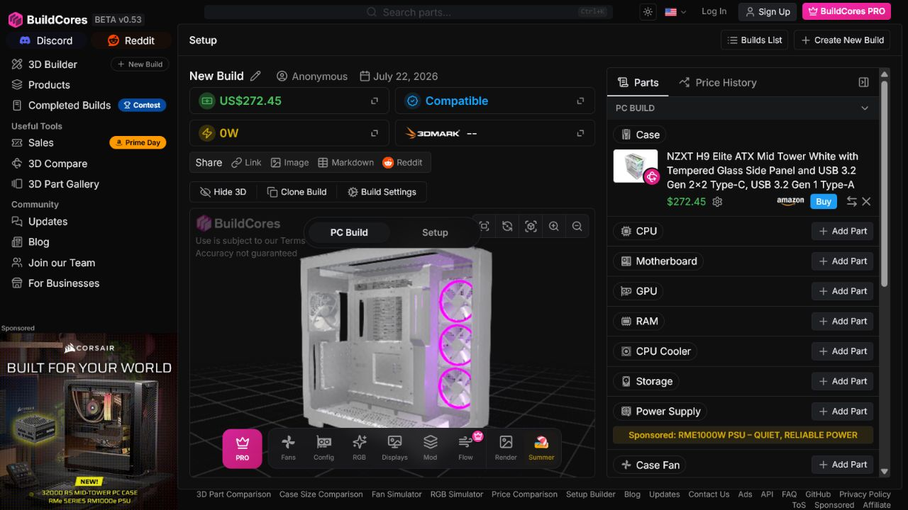

# BuildCores 深度交互审计与胖虫借鉴方案

> 审计日期：2026-07-22  
> 审计对象：[BuildCores](https://www.buildcores.com/)（页面显示 BETA v0.53）  
> 审计方式：桌面端、未登录、匿名新建配置，实际完成选件、筛选开关、兼容性错误和价格历史等交互  
> 结论用途：产品策划、胖虫 DIY 配置器改造、四人一个月任务排期和商业化风险评审

## 1. 结论先行

BuildCores 的核心价值并不只是“展示 3D 机箱”，而是把以下四件事压缩进同一个持续更新的工作台：

1. 找配件；
2. 判断兼容；
3. 观察价格、功耗和性能；
4. 用 3D 结果增强配置的可理解性和分享欲。

它已经形成较成熟的“发现—选择—反馈—纠错—分享”闭环，但仍带有明显 Beta 痕迹。对胖虫最有价值的是工作台结构、兼容性筛选和实时汇总；不应直接照搬其高密度筛选、允许无提示加入不兼容件、广告干扰及尚未完成的整套桌面模式。

综合本次可验证范围，BuildCores 交互完成度评为 **7.4/10**：

| 维度 | 评分 | 判断 |
| --- | ---: | --- |
| 核心任务可发现性 | 8.5 | 首页主行动明确，支持手工、模板和自动方案三种起点 |
| 选件效率 | 8.0 | 搜索、排序、属性筛选、库存和 3D 筛选完整，但信息密度高 |
| 配置反馈 | 9.0 | 成本、兼容性、功耗、性能和 3D 模型同步更新，反馈链完整 |
| 兼容性防错 | 7.0 | 默认过滤有效；关闭后可直接加入不兼容件，选择前缺少风险标识 |
| 价格信任 | 7.0 | 有来源、购买入口、区间和历史图；历史覆盖与当前总价口径不完全一致 |
| 3D 可用性 | 8.0 | 3D 是主工作区且可关闭；关闭后自动转为高密度表格 |
| 可访问性 | 5.5 | 有语义化导航、对话框和控件名称，但弹层隔离、无名称按钮和状态噪声存在风险 |
| 性能与稳定性 | 6.0 | 重 3D 页面对低性能设备和自动化截图不友好，必须设计轻量降级路径 |
| 整套桌面模式 | 4.5 | 已有模板和分类入口，但站内明确标记为早期开发 |

对胖虫的直接判断：**一个月可以吸收其核心交互模式，但无法在一个月内达到其数据覆盖与 3D 资产规模。** 四人团队若严格控范围，可在 4 周内完成可商测的“八大件工作台 + 强制兼容门禁 + 可追溯价格 + 3D/列表降级”；完整 3D 资产库、全量兼容规则、实时多渠道价格和整套桌面搭建仍需后续约 3–6 个月持续建设。

## 2. 审计范围与用户目标

### 2.1 用户目标

目标用户希望在不熟悉全部硬件规则的情况下，快速完成一套可购买、可解释、无关键兼容错误的 PC 配置，并能查看预算、功耗、性能和外观结果。

### 2.2 本次覆盖

- 首页进入配置器；
- 空配置的三种启动方式；
- 机箱选择器、筛选、搜索和加入配置；
- CPU 选择和 CPU→主板兼容性联动；
- 关闭兼容筛选后加入错误主板；
- 不兼容状态与详情；
- 3D/列表模式切换；
- Setup 整套桌面模式；
- 价格历史和预算占比；
- 基于页面语义结构的可访问性风险检查。

未覆盖登录、账号同步、支付、联盟跳转完成、移动端、屏幕阅读器实机和完整键盘路径。

## 3. 关键交互路径



### 步骤 1：从首页进入构建流程 — 健康



优点：

- `Start Building` 是视觉主按钮，首次进入不需要先理解产品分类；
- 首屏直接说明兼容性、价格比较、FPS 和 3D 模型，价值主张清楚；
- Quick Start 提供三套示例，降低空白页焦虑；
- 全局搜索带 `Ctrl+K` 快捷键提示，适合熟练用户。

问题：

- 左侧导航、顶部账户区、广告、底部工具链接和主内容同时抢占注意力；
- “下载 App”与“开始构建”并列，首次用户需要多做一次判断；
- 赞助内容和产品能力混排，商业化信息透明但影响主任务聚焦。

胖虫建议：保留单一主行动“开始装机”，把“模板配置”作为次行动；首页不要同时暴露过多工具和后台能力。

### 步骤 2：空配置与起步方式 — 基本健康



可见路径包括：

- Auto Build（回答问题后自动草拟）；
- Use template（使用模板后替换部件）；
- Choose case to get started（从机箱手工开始）；
- 右侧也可直接选择任一部件；
- 可随时切到 Setup 桌面模式。

优点：同时服务新手、半熟练用户和专家。

问题：首次进入同时出现中央引导层、右侧配件列表和顶部大量指标，信息优先级不够单一。“从机箱开始”是一种产品选择，不应伪装成唯一正确顺序。

胖虫建议：

- 新手默认显示“按推荐顺序装机”；
- 专家可切换“任意顺序”；
- 自动方案先收集预算、用途、分辨率、偏好品牌和已有配件，展示选择理由后才写入配置；
- 模板必须显示“适用场景、预算区间、可替换范围”。

### 步骤 3：Quick Add 选件器 — 功能强、认知负担偏高



本次机箱选择器显示 3,713 个兼容产品，共 3,728 个产品。左侧提供价格、制造商、颜色、板型、主板尺寸、显卡限长、散热限高、扩展槽、侧板等筛选；右侧卡片同时给出图片、3D 标签、价格和关键规格。

优点：

- 筛选项与当前部件类型动态变化，不是“一套筛选器套全部分类”；
- “兼容产品数 / 全部产品数”让系统判断可见；
- 卡片只展示影响决策的少量规格；
- 数据问题可直接跳转开源数据库反馈。

问题：

- 左栏默认展开的筛选组过多，首次用户需要理解大量硬件术语；
- 价格范围、属性按钮、复选框和快捷筛选的交互形式不统一；
- 多个结果名过长，卡片高度和扫读效率受影响；
- “Sponsored”与自然结果同列，需要更强的广告边界。

胖虫建议：默认只展示“预算、品牌、关键兼容参数”三组；高级参数折叠到“更多筛选”。筛选变化后在结果区顶部展示可撤销的条件标签。

### 步骤 4：搜索与结果相关性 — 需要改进



输入精确型号 `NZXT H9 Elite` 后仍显示 179 个结果，首屏前两项与查询高度相关，但大量 H9 Flow 和其他 NZXT 产品也被纳入。

判断：这是“召回率优先”的模糊搜索，但没有解释匹配逻辑，也没有“完全匹配”分组。对商业化选购，用户更需要确定性。

胖虫建议采用三级排序：

1. 完全型号匹配；
2. 品牌 + 系列匹配；
3. 规格或描述近似匹配。

搜索结果需标注“完全匹配 / 同系列 / 相关结果”，并把精确型号稳定放在首位。

### 步骤 5：加入配置后的实时反馈 — 很健康



加入机箱后，系统同时完成：

- 总成本从 0 更新为 US$272.45；
- 兼容性保持 Compatible；
- 右侧部件行显示型号、渠道、购买入口和移除操作；
- 中央 3D 立即装载所选机箱；
- 3D 区提供旋转、缩放、AR、风扇、RGB、显示器、模块化、气流和渲染入口；
- 顶部支持链接、图片、Markdown 和 Reddit 分享。

这是 BuildCores 最值得借鉴的部分：一次选择同时影响视觉结果、商业结果和工程判断，用户无需去多个页面验证。

胖虫已有相近基础：[`DIY.vue`](../../ecommerce/frontend/src/views/DIY.vue) 已提供八步选件、配置汇总、兼容检查、功耗、机箱冗余、价格记录和加入购物车；[`Product3DViewer.vue`](../../ecommerce/frontend/src/components/Product3DViewer.vue) 已具备 GLB、降级模型、减弱动态效果和装配节点检查。改造重点应是信息架构与状态统一，而不是重写全部功能。

### 步骤 6：CPU 选择 — 功能健康，展示密度偏高

CPU 选择器提供品牌、插槽、核心数、TDP、系列、架构、核显、内存类型和是否附带散热器等筛选。本次在仅选择机箱时显示 787 个“兼容”CPU，共 789 个产品。

风险：机箱几乎不约束 CPU，此时使用“兼容产品”会让用户误以为系统已完成强约束判断。更准确的文案应是“当前未发现冲突”，并说明仍缺少主板等前置条件。

本步骤截图未保存成功；数字、字段和候选结果来自同一页面当次 DOM/可访问性结构，不作为视觉细节证据。

### 步骤 7：CPU 到主板的兼容联动 — 健康

选择 AMD Ryzen 7 7800X3D 后：

- 总价从 US$272.45 更新为 US$621.44；
- 估算功耗从 0W 更新为 120W；
- 主板选择器从 3,693 款缩小到 493 款；
- 首屏结果均为 AM5 主板，符合 CPU 插槽约束。

这是正确的默认防错模式。胖虫应把兼容过滤作为领域规则，而不是页面内的临时过滤条件，并保留“为什么被过滤”的说明入口。

### 步骤 8：关闭兼容过滤并制造错误 — 高风险但错误详情清楚

关闭兼容过滤后，主板候选变为 3,688 / 3,693，首屏混入 LGA 1700、AM4、sTR5 等不兼容插槽。卡片未明显标记“不兼容”，`Add to build` 仍可用。

加入 LGA 1700 的 ASUS TUF GAMING B760-PLUS WIFI 后：

- 全局状态立即变为 Incompatible；
- 页面提示 CPU 与主板不兼容；
- 兼容性详情分别指出 CPU 和主板的插槽冲突；
- 详情同时声明仍有部分规则未实现，例如冷排/风扇影响显卡空间、散热器与内存净空等。

核心问题不是“允许专家关闭过滤”，而是关闭后缺少逐卡风险标识和添加前确认。错误发生后只有解释，没有一键修复路径。

胖虫商业化门槛：

- 不兼容商品卡必须红色标识原因；
- 点击选择时先弹出风险确认，不允许静默加入；
- 加入购物车必须硬阻断关键冲突；
- 每条冲突提供“替换 CPU / 替换主板 / 恢复兼容筛选”动作；
- 未实现的规则必须明确列入“未验证项”，不能显示为“兼容”。

胖虫当前 `addToCart()` 已会阻断 `warn` 级兼容问题，这是比 BuildCores 本次路径更适合电商成交的基础，必须保留。

### 步骤 9：关闭 3D 后的降级体验 — 健康但标签含义可更清楚

点击 Hide 3D 后，中央 3D 工作区被移除，部件区从侧边卡片变为完整表格，显示库存、价格、渠道、购买和移除操作。

优点：低性能设备或只关心规格的用户可以获得更高信息密度。

问题：按钮文案只说“隐藏 3D”，实际同时改变了主布局；这是超出按钮预期的状态变化。

胖虫建议使用明确模式切换：`3D 工作台 / 清单模式`，并记住用户偏好。3D 加载失败、设备性能不足或开启减少动态效果时，自动进入清单模式并告知原因。

### 步骤 10：Setup 整套桌面模式 — 尚不适合当作成熟标杆

Setup 模式提供“电竞桌面”“生产力桌面”和“空桌面”三种起点，分类包括桌子、椅子、鼠标垫、支架、灯光、整机、笔记本、显示器、键鼠、麦克风、耳机、VR、音箱、摄像头和配件。

但站内弹层明确标记为早期开发，并说明完整产品、模块化交互、灯光/环境/房间装饰和分享能力仍在建设中。因此用户提供的 Setup Items 视觉可作为图标和分类导航参考，不能把它当作已验证的成熟商业流程。

胖虫建议把此能力放在第二阶段：第一月只预留数据模型和导航入口，不纳入商业化上线门槛。

### 步骤 11：价格历史与预算占比 — 有价值，口径需更透明

价格历史提供 30d、60d、90d、Max 时间范围，展示整套配置的价格曲线、总预算和各部件预算占比。本次三件套总价为 US$806.39，CPU、机箱和主板占比分别约 43.3%、33.8%、22.9%。

系统同时提示 Amazon 价格不纳入历史曲线。这说明“当前可购买总价”和“可绘制历史的价格来源”不是同一覆盖范围。

胖虫应继续使用已有 [`PriceProvenance.vue`](../../ecommerce/frontend/src/components/PriceProvenance.vue) 的可追溯设计，并补充：

- 当前总价覆盖了哪些渠道；
- 历史图包含了哪些渠道、缺失哪些渠道；
- 每个点的采集时间、币种、税费/运费口径；
- 数据过期或样本不足时不显示“历史低价”；
- 国内渠道使用胖虫自己的价格、库存和渠道数据，不能把 OpenDB 当作价格源。

## 4. 信息架构拆解

BuildCores 使用稳定的三层结构：

| 区域 | 作用 | 胖虫处理 |
| --- | --- | --- |
| 左侧全局导航 | Builder、产品、成品方案、工具、社区 | 商业化首月收敛为“装机、商品、订单、服务” |
| 顶部全局栏 | 搜索、主题、地区、账户、PRO | 保留搜索、地区和账户；PRO 延后 |
| 中央工作区 | 3D 或清单、引导层、结果反馈 | 作为 DIY 主工作区 |
| 顶部指标卡 | 成本、兼容、功耗、性能 | 胖虫改为总价、兼容、功耗、预算完成度 |
| 右侧配置栏 | 部件列表、价格历史、购买入口 | 胖虫合并现有配置清单与价格来源 |
| Quick Add 弹层 | 分类化筛选、搜索和结果卡片 | 从 `DIY.vue` 拆出独立选件器 |

胖虫现在的 [`DIY.vue`](../../ecommerce/frontend/src/views/DIY.vue) 把选件、筛选、3D、兼容、价格、快照和购物车编排集中在一个页面文件中。功能覆盖已经不错，但继续叠加 BuildCores 式交互会提高维护风险。

建议目标结构：

```text
ecommerce/frontend/src/
├─ views/diy/
│  └─ DIYWorkbench.vue
├─ components/diy/
│  ├─ BuildSummaryBar.vue
│  ├─ BuildModeSwitch.vue
│  ├─ PartsRail.vue
│  ├─ PartPickerDialog.vue
│  ├─ PartFilters.vue
│  ├─ PartResultCard.vue
│  ├─ BuildPartsTable.vue
│  ├─ CompatibilityPanel.vue
│  └─ PriceHistoryPanel.vue
├─ stores/
│  └─ diyBuilder.ts
├─ domain/diy/
│  ├─ compatibility.ts
│  ├─ metrics.ts
│  └─ snapshot.ts
└─ services/
   ├─ catalogSearch.ts
   └─ priceHistory.ts
```

这与 [`02-directory-and-architecture-plan.md`](02-directory-and-architecture-plan.md) 的“控制边界、渐进拆分”原则一致；第一月只迁移状态和规则，不重写 Three.js 渲染器。

## 5. 可访问性风险

以下是截图与页面语义结构能支持的风险判断，不等同于完整 WCAG 审计：

### 已确认的正面信号

- 主导航有语义名称；
- 主要动作、指标卡、筛选、对话框和关闭按钮大多有可访问名称；
- 选件器使用 `dialog`，价格图使用 `application`/图像描述；
- 3D 控件在稳定状态下具备旋转、缩放、全屏等名称；
- 胖虫 `Product3DViewer.vue` 已监听 `prefers-reduced-motion`。

### 高概率问题

- 弹层打开时，背景工作台仍完整出现在可访问性结构中，可能没有正确使用 `inert`、焦点陷阱或 `aria-hidden`；
- Setup Builder 弹层存在两个同名 `Close`，对语音控制和屏幕阅读器用户不够明确；
- 多个加载包装器反复暴露 `Loading...` 状态，可能造成读屏噪声；
- 部分图标按钮在加载阶段没有可访问名称；
- 关闭兼容筛选后，不兼容性主要依靠后续状态变化表达，选择前缺少文本风险提示；
- 3D/清单布局切换是大范围状态变化，需要把结果通过状态文本通知辅助技术；
- 美国区域下价格图日期按浏览器语言显示中文，地区、币种和日期格式可能不同步。

胖虫验收必须增加：完整键盘走通、焦点回归、弹层背景不可聚焦、200% 缩放、减少动态效果、颜色之外的状态表达和 NVDA/VoiceOver 抽测。

## 6. 胖虫一个月内的修改优先级

### P0：必须完成

1. 把兼容规则从页面计算逻辑拆到领域模块，并支持规则 ID、原因、证据字段和修复动作；
2. 默认只展示兼容候选，未验证与不兼容必须分开；
3. 购物车和结算继续硬阻断关键兼容错误；
4. 建立 Quick Add 弹层：搜索、三组核心筛选、结果计数、完全匹配优先；
5. 建立统一 DIY store，让选择一次性驱动总价、功耗、兼容、3D、快照和价格历史；
6. 3D 加载失败或性能不足时自动切换清单模式；
7. 价格来源、检查时间和历史覆盖口径必须可见。

### P1：一个月内尽量完成

1. 模板配置和推荐理由；
2. 兼容问题的一键替换建议；
3. 30/60/90 天价格范围和预算占比；
4. 配置链接或 JSON/Markdown 导出；
5. 焦点管理、弹层隔离和读屏状态优化；
6. 桌面端 1280px 与移动端 390px 的响应式验证。

### P2：后续阶段

1. 自动问答式 Auto Build；
2. 风扇、RGB、气流、模块化和 AR 高级交互；
3. 桌面/椅子/外设的完整 Setup Builder；
4. 大规模原创 3D 资产生产和自动装配节点标注；
5. 社区方案、竞赛和 PRO 订阅。

## 7. 四周落地建议

| 周次 | 目标 | 可验收产物 |
| --- | --- | --- |
| 第 1 周 | 拆分 DIY 状态与领域规则 | `diyBuilder` store、兼容规则接口、旧流程回归测试 |
| 第 2 周 | 完成选件器与搜索相关性 | Quick Add、完全匹配排序、核心筛选、兼容/未验证/不兼容分组 |
| 第 3 周 | 完成实时汇总与轻量降级 | 指标栏、清单模式、3D 自动降级、价格来源与历史覆盖说明 |
| 第 4 周 | 商测门禁 | 键盘/读屏抽测、性能预算、端到端装机—购物车—结算、风险修复 |

建议验收指标：

- 首次用户 30 秒内完成第一个配件选择；
- 精确型号搜索的正确商品稳定排第 1；
- 所有关键不兼容配置无法进入购物车；
- 每条阻断错误都能说明原因并给出至少一个修复动作；
- 3D 失败不阻断选件、价格和下单；
- 筛选、选择和指标更新都有可见加载/成功/失败状态；
- 价格记录没有来源和时间戳时，不显示已核验或历史低价。

## 8. 借鉴边界与数据合规

- 可借鉴交互模式、信息结构和状态设计；
- 不直接复制 BuildCores 的图标、3D 模型、截图、品牌视觉或代码；
- `buildcores-open-db` 可作为硬件规格与兼容数据参考，使用前必须遵守 ODC-By 1.0 署名要求；
- 数据库许可不自动覆盖所有图片、模型和第三方内容，素材许可需逐项确认；
- OpenDB 不提供适合胖虫国内成交的实时价格、库存和渠道数据，必须维护独立商业数据源；
- 导入数据前建立字段映射、来源、版本、更新时间和撤回机制。

## 9. 证据边界

- 本报告的 5 张截图均为本次审计实际保存并核验的页面状态；
- 加入 CPU 后，BuildCores 重 3D 页面持续出现浏览器截图超时，因此步骤 6–11 的结论使用同一会话中的页面语义结构和可见状态数据，并已明确标注无截图部分；
- 未验证登录同步、购买跳转、分享结果、移动端和完整辅助技术表现；
- 兼容性结论仅代表本次三个样本部件和页面当时实现，不代表 BuildCores 全部规则准确；
- 页面声明部分兼容检查仍未实现，因此胖虫不能把 BuildCores 的“Compatible”直接当作商业承诺。

## 10. 产品决策建议

胖虫应选择“**BuildCores 的反馈闭环 + 胖虫的交易门禁与价格溯源**”路线：

- 学 BuildCores 的工作台、选件器、指标联动和 3D/清单双模式；
- 保留胖虫现有购物车硬阻断和价格来源组件；
- 首月不做整套桌面、不追求 5,000+ 3D 模型、不做复杂社区功能；
- 把预算优先级放在兼容准确、价格可追溯、失败可恢复和真实结算链路上。

这条路线能在一个月内明显提高演示完成度和邀请制商测能力，同时避免把 3D 展示误当成商业化完成。
